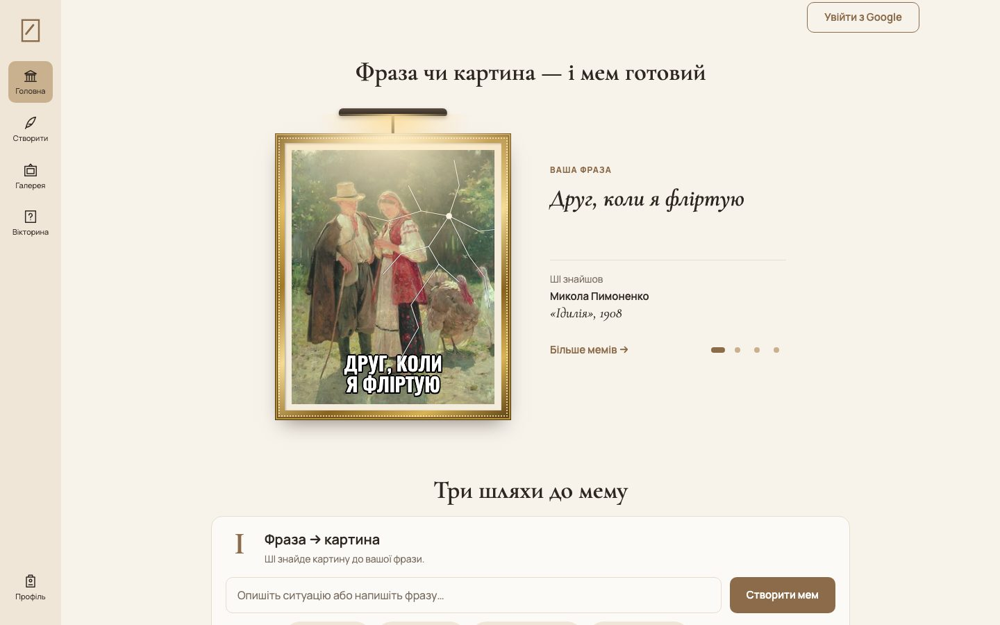
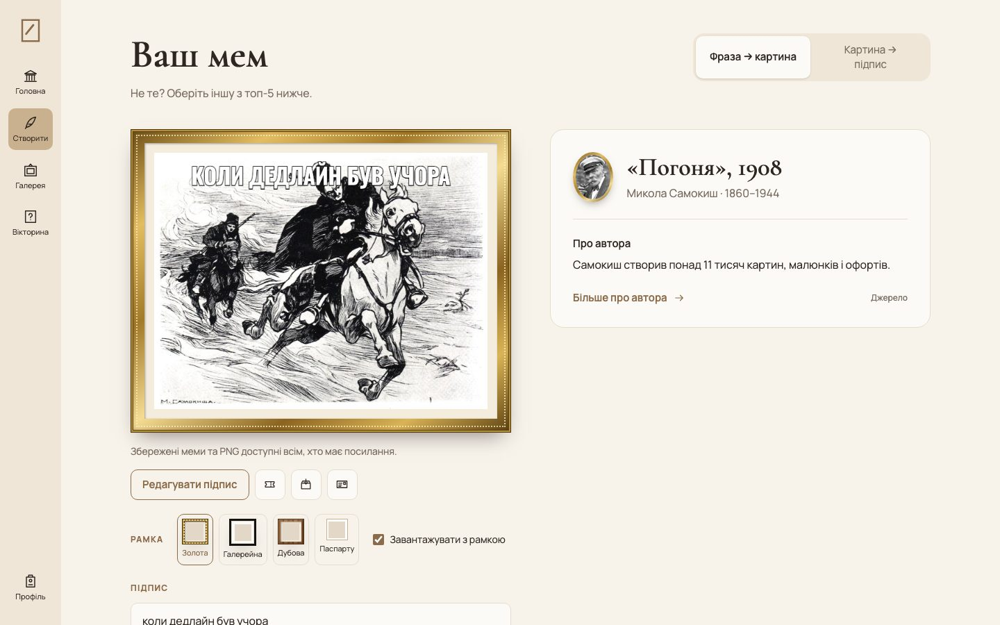
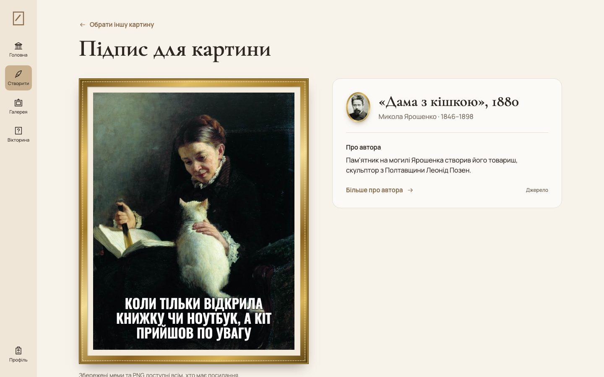
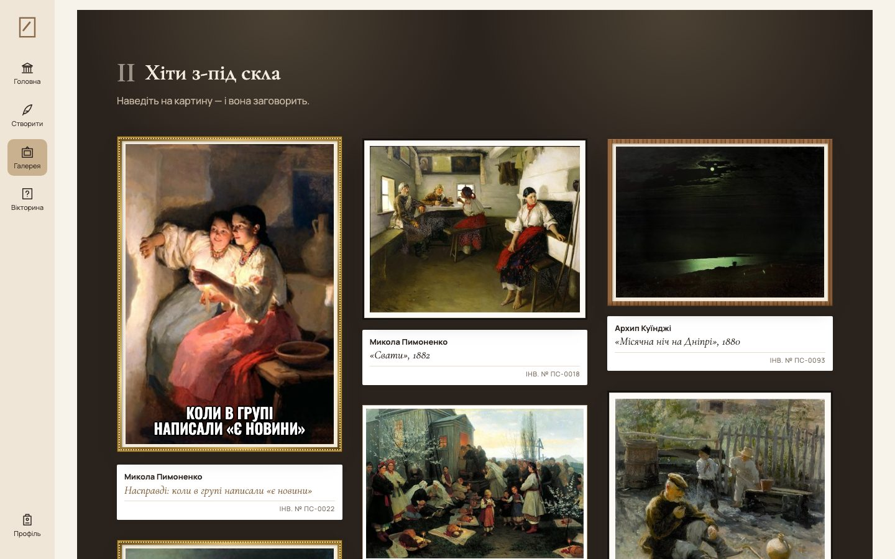
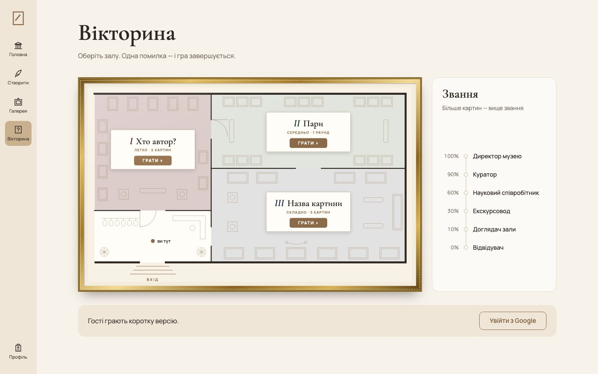
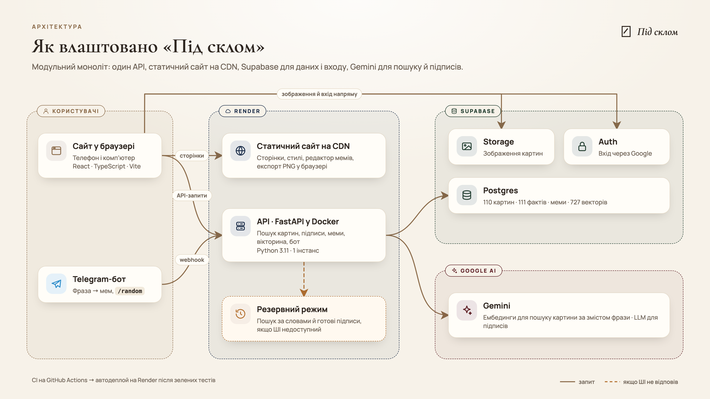
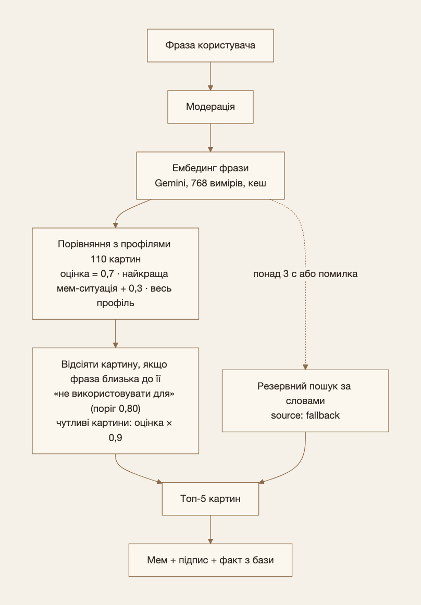
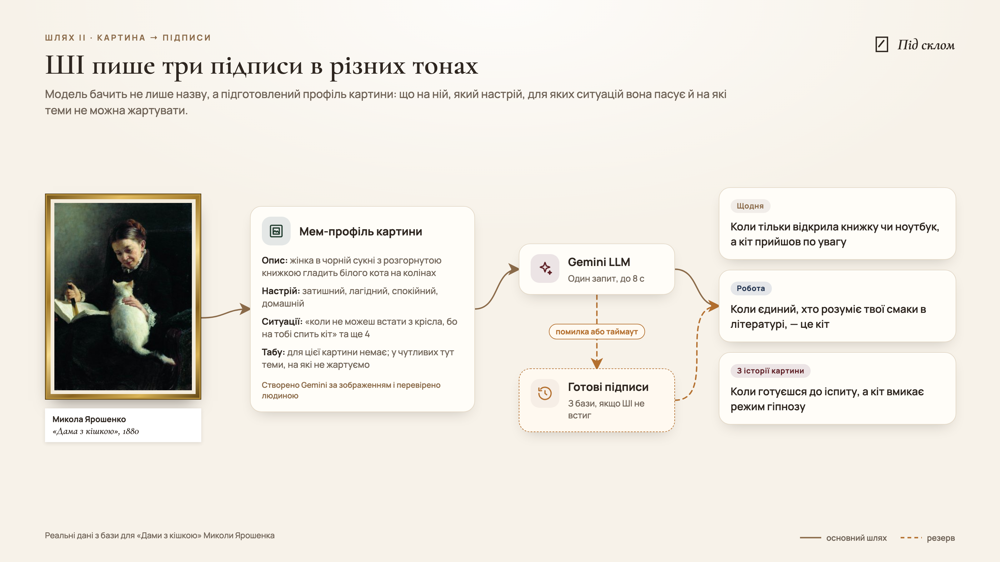
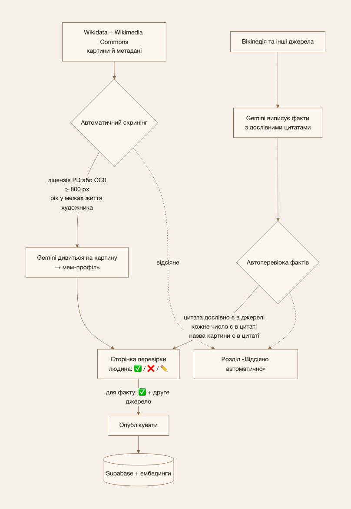

# Під склом

**Мистецтво крізь жарти.** Напишіть фразу, і ШІ знайде українську картину, яка її «проілюструє». Або оберіть картину, і ШІ запропонує підписи. За секунди виходить мем, а поруч з ним перевірений факт про картину чи художника.

**Сайт:** https://pidsklom-web-bhw6.onrender.com  
**Telegram-бот:** [@pid_sklom_bot](https://t.me/pid_sklom_bot)



> **Речення MVP.** Українці вдома й за кордоном, яким українське мистецтво здається далеким і «музейним», хочуть за хвилину зробити смішний мем зі своєї фрази й поділитися ним, і разом із жартом дізнаються справжній факт про картину та її автора. Наш MVP показує це на **110 картинах 10 українських художників** у суспільному надбанні; кожен факт має джерело й пройшов перевірку людиною.

---

## Зміст

1. [Проблема](#1-проблема)
2. [Чому це важливо для культури](#2-чому-це-важливо-для-культури)
3. [Рішення: що робить користувач](#3-рішення-що-робить-користувач)
4. [Що вже зроблено](#4-що-вже-зроблено)
5. [Як це працює: архітектура й ШІ](#5-як-це-працює-архітектура-й-ші)
6. [Дані: звідки контент і як ми його перевіряємо](#6-дані-звідки-контент-і-як-ми-його-перевіряємо)
7. [Технічна реалізація: що працює, що ні](#7-технічна-реалізація-що-працює-а-що-ні)
8. [Підтримуваність і масштабування](#8-підтримуваність-і-масштабування)
9. [Аудиторія: перші 100 користувачів](#9-аудиторія-перші-100-користувачів)
10. [План розвитку на 3, 6 і 12 місяців](#10-план-розвитку-на-3-6-і-12-місяців)
11. [Після хакатону: партнерства й соціальний вплив](#11-після-хакатону-партнерства-й-соціальний-вплив)
12. [На що піде грант](#12-на-що-піде-грант)
13. [Відповіді на 5 питань організаторів](#13-відповіді-на-5-питань-організаторів)
14. [Команда й запит](#14-команда-й-запит)
15. [Запуск локально](#15-запуск-локально)
16. [Документація для розробників](#16-документація-для-розробників)

---

## 1. Проблема

Українське мистецтво зараз фізично й психологічно далеко від багатьох українців.

**Музеї недоступні.** За останніми даними Міністерства культури, **141 музей і галерея пошкоджені або зруйновані** ([Hyperallergic, за даними Мінкульту](https://hyperallergic.com/russia-has-damaged-or-destroyed-over-4-500-cultural-sites-in-ukraine/)). Ще в 2024 році з музеїв евакуювали **понад 453 тисячі експонатів** ([Українська правда](https://www.pravda.com.ua/eng/news/2024/07/04/7464088/)). Багато музеїв замість постійних експозицій показують лише тимчасові виставки, а зали найвідоміших колекцій стоять майже порожні ([ICOM UK](https://uk.icom.museum/current-armed-conflict-series-ukrainian-museums/)). Картини заховані заради безпеки, і їх просто ніде побачити.

**Мільйони українців за кордоном.** UNHCR налічує **5,86 млн біженців з України** у світі станом на грудень 2025 року ([UNHCR](https://www.unhcr.org/sites/default/files/2026-06/global-report-2025-situation-overview-ukraine.pdf)). Діти, які ростуть у Польщі чи Німеччині, можуть роками не бачити жодної української картини наживо.

**«Мистецтво — це нудно».** Навіть коли музей поруч, класичне мистецтво здається чимось далеким: шкільна програма, суворі підписи, «треба знати». Люди живуть у стрічках, а не в залах музеїв. За опитуваннями 2025 року, Telegram — головне джерело новин для **51–62 % українців**, а серед 18–34-річних — для **84–87 %** ([Українська правда](https://www.pravda.com.ua/eng/news/2025/09/25/7532494), [Ipsos через dev.ua](https://dev.ua/en/news/telegram-became-the-main-source-of-news-for-ukrainians-in-2025-ipsos-study)). Українські картини в цих стрічках майже не трапляються.

**Узагальнений образ користувачки** (не інтерв'ю). Оля, 27 років, з 2022-го живе в Кракові. Вона сумує за домом, але до музею в Києві не потрапить, а «Ідилію» Пимоненка востаннє бачила в підручнику. Вона щодня кидає друзям меми, і жоден з них не про українське мистецтво.

Звідси наша ідея: **принести картини туди, де люди вже є, у мови, якою вони вже говорять, тобто в меми.**

## 2. Чому це важливо для культури

- **Мем як вхідні двері.** Людина приходить по жарт, а йде з іменем художника, назвою картини й фактом про них. Кожен мем несе атрибуцію: автора, назву, рік.
- **Картини з-під скла.** Звідси назва. Ми дістаємо твори зі сховищ і вітрин та повертаємо їх у щоденні розмови, поки самі оригінали в безпеці.
- **Сміх теж потрібен.** У війну людям потрібно іноді сміятися. Спільний жарт об'єднує, а якщо він ще й про Куїнджі чи Шевченка, то разом із ним ширяться імена й історії.
- **Українською й про своє.** Інтерфейс, підписи й факти українською. Колекція — українські художники, твори яких стали суспільним надбанням.
- **Чесно щодо фактів.** ШІ підбирає картину й жартує, але не пише історію мистецтва. Факти беруться тільки з бази, і кожен має джерело та перевірку людиною (див. [розділ 6](#6-дані-звідки-контент-і-як-ми-його-перевіряємо)).

## 3. Рішення: що робить користувач

Три шляхи до мему, кожен займає хвилину:

| Шлях | Що робить користувач | Що робить система |
|---|---|---|
| **I. Фраза → картина** | пише «коли дедлайн був учора» | ШІ знаходить 5 найкращих картин, накладає підпис, показує факт |
| **II. Картина → підпис від ШІ** | обирає картину в галереї | ШІ пропонує три підписи: «щодня», «робота», «з історії картини» |
| **III. Картина → свій підпис** | обирає картину й пише сам | редактор: шрифт, колір, розташування, рамка |

Далі мем можна відредагувати, завантажити PNG, поділитися посиланням або зберегти в «Мої меми» (вхід через Google).

Поруч із мемами є ще три зали:

- **Галерея** з усіма картинами й художниками за жанрами. Окрема зала «Хіти з-під скла»: наведіть на картину, і вона «заговорить».
- **Вікторина** з трьох ігор: «Хто автор?», «Пари», «Назва картини». Одна помилка, і гра завершується. Звання ростуть від «Відвідувача» до «Директора музею».
- **Telegram-бот:** надішліть фразу й отримайте мем, або `/random` — випадкову картину з трьома підписами на вибір.

| Результат: фраза → картина | Підписи від ШІ до обраної картини |
|---|---|
|  |  |

| Зала «Хіти з-під скла» | Вікторина: план музею |
|---|---|
|  |  |

## 4. Що вже зроблено

Цифри з робочої бази станом на 20 листопада 2026:

| | |
|---|---|
| Картини в каталозі | **110** (усі в суспільному надбанні, усі переглянуті людиною; 2 відхилено) |
| Художники | **10**: Шевченко, Пимоненко, Мурашко, Куїнджі, Малевич, Новаківський, Самокиш, Васильківський, Ярошенко, Красицький |
| Перевірені факти | **111** (37 про картини, 74 про художників), у кожного є джерело |
| Мем-профілі й вектори для пошуку | **110** картин, **727** векторів (профіль і окремі «мем-ситуації» кожної картини) |
| Чутливі картини | **10** позначено: для них ШІ знижує пріоритет і не жартує на заборонені теми |
| Збережені меми | **17** (від команди й перших тестувальників) |
| Автотести | **понад 240** тестів бекенду + 4 браузерні набори (14 сторінок × 7 ширин екрана, доступність, вхід, історії картин) |

Розгорнуто й працює: сайт, API, вхід через Google, гостьові ліміти, пошук картин через Gemini, підписи від ШІ, вікторина, Telegram-бот. Деталі чесно розписано в [розділі 7](#7-технічна-реалізація-що-працює-а-що-ні).

## 5. Як це працює: архітектура й ШІ

### Система

Модульний моноліт: один API, статичний фронтенд на CDN, Supabase для даних, файлів і входу. Кожна зовнішня залежність має локальну заглушку, тож проєкт запускається без жодного ключа.



- **Фронтенд:** React 19, TypeScript, Vite, Tailwind v4. Редактор мемів на react-konva, PNG експортується просто в браузері.
- **Бекенд:** Python 3.11, FastAPI, Pydantic. Pillow рендерить меми для Telegram, aiogram обслуговує бота.
- **Дані:** Supabase (Postgres, Storage, Auth). Колонка для векторів у схемі вже має тип `vector(768)`, готовий до pgvector.
- **CI/CD:** GitHub Actions (тести бекенду, збірка й браузерні перевірки фронтенду, збірка Docker-образів). Після зеленого CI Render автоматично розгортає `main`.

### Шлях I: фраза → картина

Пошук за змістом, а не за словами: фраза «коли кіт заважає працювати» знайде «Даму з кішкою», хоча слова «кішка» в ній немає.



Відповідь завжди позначена джерелом: `embeddings` (ШІ) або `fallback` (резерв). Користувач ніколи не бачить помилки ШІ. Якщо Gemini недоступний, спрацьовує резервний пошук, і мем однаково виходить.

### Шлях II: картина → підписи



### Як ми боремося з вигадками ШІ

- **ШІ не пише факти.** Факти на сторінці беруться тільки з таблиці `facts`. Туди вони потрапляють після автоматичних перевірок і схвалення людиною (див. [розділ 6](#6-дані-звідки-контент-і-як-ми-його-перевіряємо)).
- **ШІ обирає, а не вигадує.** У шляху I модель лише ранжує картини з каталогу. Ідентифікатори, яких немає в базі, відкидаються.
- **Табу для кожної картини.** У профілі є поле «не використовувати для» (наприклад, «образливі жарти про віруючих»). Фраза, близька до табу, цю картину не отримає.
- **Відома межа.** Підпис типу «з історії картини» модель пише з профілю, а не з перевірених фактів, тож він може бути неточним. Це записано в [KNOWN_ISSUES](docs/KNOWN_ISSUES.md), і виправлення заплановано на перші 3 місяці.

## 6. Дані: звідки контент і як ми його перевіряємо

Один скрипт збирає все про художника: картини, мем-профілі, факти, біографію. Потім людина перевіряє все на окремій сторінці й натискає «Опублікувати». Нічого не потрапляє на сайт без людини.



- **Права.** Беремо лише художників, які померли в 1955 році або раніше: в Україні їхні твори є суспільним надбанням. Файли з Commons мають ліцензію Public Domain або CC0.
- **Атрибуція.** У кожної картини є автор, назва, рік і посилання на джерело. У кожного факту є джерело.
- **Чутливість.** Картини на релігійні, воєнні й трагічні теми позначаються як чутливі. Для них діють табу й нижчий пріоритет.
- **Відтворюваність.** Етапи можна перезапускати: готове пропускається, рішення людини зберігаються. Модель, яка написала кожен профіль чи факт, записується. Деталі у [DATA_PIPELINE](docs/DATA_PIPELINE.md).

Скільки це коштує в часі: один прохід скрипта додає художника з ~12 картинами. Найдовша частина — перевірка людиною, і саме вона гарантує якість.

## 7. Технічна реалізація: що працює, а що ні

| Функція | Статус |
|---|---|
| Сайт і API на Render, автодеплой після CI | ✅ працює |
| Пошук картини за фразою (ембединги Gemini) + резервний пошук | ✅ працює |
| Підписи від ШІ до картини + резервні підписи | ✅ працює (підпис «з історії» може бути неточним, див. вище) |
| Редактор мемів, рамки, експорт PNG із водяним знаком | ✅ працює |
| Вхід через Google, «Мої меми», улюблені, посилання для поширення | ✅ працює |
| Гостьові ліміти: 3 генерації й 3 PNG без входу | ✅ працює |
| Вікторина: 3 ігри, рекорди, звання, підписані токени | ✅ працює |
| Галерея, художники, зала «Хіти з-під скла», картини на весь екран | ✅ працює |
| Telegram-бот (фраза → мем, `/random`) | 🟡 пілот: організатори за списком ID; гості демо-події заходять за персональним посиланням і мають ліміт 5 запитів (облік у Supabase) |
| Конвеєр збору даних і сторінка перевірки | 🟡 працює локально в команди; адмін-панелі на сайті немає |
| Гібридне ранжування (ембединги + LLM-переранжування) | ⚪ заготовка: перемикач є, зараз працюють лише ембединги |
| Модерація фраз | ⚪ заготовка: перевірка викликається, але список заборонених слів порожній |
| Обмеження частоти запитів для зареєстрованих | ⚪ немає (є лише гостьові ліміти) |
| «Про картину»: історії самих картин | ⚪ поки порожньо для всіх 110 картин; на сторінці показуються факти |
| Повна приватність мемів | ⚪ збережені меми доступні всім, хто має посилання (про це сказано на сайті) |

## 8. Підтримуваність і масштабування

**Підтримуваність**

- **Перемикачі замість переписування.** Дані (`local` / `supabase`), ШІ (`stub` / `llm`) і вхід (`stub` / `supabase` / `disabled`) вмикаються у `.env`. Без ключів усе працює на заглушках, тож новий учасник запускає проєкт за 5 хвилин.
- **Записані рішення.** 9 [ADR](docs/adr/) пояснюють, чому обрано Supabase, ембединги, Render, гостьові ліміти й вікторини.
- **Один контракт API.** `backend/app/schemas.py` дзеркалиться у `frontend/src/api/types.ts`. Живий опис на `/docs` (Swagger).
- **Тести на кожен PR.** Понад 180 тестів бекенду. Браузерні перевірки проходять 14 сторінок на 7 ширинах екрана, доступність (200 % тексту, клавіатура, фокус), вхід і чернетки. Збираються обидва Docker-образи.
- **Захист від помилок у продакшені.** `ENVIRONMENT=production` не запуститься з заглушками, неперевіреним контентом чи HTTP.

**Масштабування**

- **Навантаження.** API без стану, тож можна додавати інстанси. Фронтенд роздає CDN, зображення йдуть зі Storage напряму, не через API.
- **Каталог.** Ранжування в пам'яті (NumPy) швидке для тисяч картин. Коли каталог виросте, колонка `vector(768)` уже є в схемі для пошуку в pgvector.
- **Вартість.** Зараз API працює на одному інстансі Render за **$7/міс**, статичний сайт безкоштовний. Кожна нова фраза — це один дешевий виклик ембедингів; повтори беруться з кешу. Наступні кроки за [дослідженням Render](docs/RENDER_RESEARCH.md): Supabase Pro ($25/міс) з бекапами, потужніший інстанс ($25/міс).
- **Контент.** Нового художника додає один скрипт, а не розробник. Масштабується людьми-перевіряльниками, і саме на них потрібен грант.

## 9. Аудиторія: перші 100 користувачів

Ми не шукаємо «всіх українців». Перші 100 — це конкретні групи, до яких ми маємо прямий доступ:

| Група | Скільки | Як дійдемо | Що перевіряємо |
|---|---|---|---|
| Студенти й викладачі нашого університету, учасники хакатону | 30 | особисто, університетські чати | чи зрозумілий сценарій без пояснень |
| Вчителі історії та мистецтва зі своїми класами | 25 | 2–3 школи, урок у форматі мем-вечірки | чи запам'ятовують учні художників |
| Українці за кордоном | 25 | українські суботні школи й Telegram-спільноти діаспори | чи повертаються самі через тиждень |
| Адміни мем- і арт-каналів у Telegram | 20 | пряме запрошення, тематичні добірки | чи поширюють меми далі |

Далі ці ж канали масштабуються: школи через громадські організації та Міносвіти, діаспора через мережу суботніх шкіл, широка аудиторія через Telegram, з якого новини отримує більшість українців.

## 10. План розвитку на 3, 6 і 12 місяців

**3 місяці: якість і перші партнери**
- Історії для кожної з 110 картин, перевірені мистецтвознавцем (зараз 0 з 110).
- Підписи «з історії картини» тільки на основі перевірених фактів.
- Модерація фраз і ліміти запитів, щоб відкрити Telegram-бот для всіх.
- +5 художників (≈ +60 картин) через наш конвеєр.
- Пілот у 2 школах і перша тематична мем-вечірка.

**6 місяців: зростання колекції й освіта**
- 300+ картин, 20 художників, зокрема художниці й регіональні школи живопису.
- Перша комерційна співпраця з приватним музеєм чи фондом і перша безкоштовна програма для малого музею.
- Набір для вчителів: план уроку, вікторина за темою, мем-челендж.
- Гібридне ранжування (ембединги + переранжування LLM) для точнішого підбору.

**12 місяців: мережа музеїв**
- 1000+ картин, 3–5 експедицій до маловідомих місцевих музеїв.
- Курси для дітей і дорослих про українське мистецтво через меми.
- Можливість для музеїв самостійно подавати свої колекції на перевірку.
- Англійська версія для друзів українців за кордоном і для іноземців.

## 11. Після хакатону: партнерства й соціальний вплив

**Як ростиме база**
- **Конвеєр для нових художників.** Один запуск = художник із картинами, профілями й фактами на перевірку.
- **Експедиції до місцевих музеїв.** У районних і сільських музеях зберігаються роботи художників, про яких майже немає інформації онлайн. Ми їздимо, фотографуємо (з дозволу), записуємо історії від працівників музею й публікуємо з атрибуцією.
- **Колекції партнерів.** Музеї й фонди передають оцифровані твори, ми робимо з них зали, вікторини й меми.

**Модель «один за одного»**

Комерційна співпраця з приватним музеєм чи фондом (власна зала, вікторина за їхньою колекцією, мем-вечірка на відкритті виставки) фінансує те саме **безкоштовно** для малого музею, школи чи бібліотеки. Великі допомагають малим бути помітними.

**Співпраця**
- **Приватні музеї й фонди:** зали за їхніми колекціями, кампанії до виставок.
- **Школи:** уроки з мемами й вікторинами, домашнє завдання «зроби мем про Куїнджі й розкажи, чому саме ця картина».
- **Освітні курси для дітей і дорослих:** короткі курси історії українського мистецтва, де кожен модуль закінчується власним мемом.
- **Громадські організації й діаспора:** суботні школи, культурні центри за кордоном.

**Мем-вечірки**

Тематичні зустрічі, онлайн чи наживо, присвячені одному художнику або жанру: «вечір Куїнджі», «Малевич і понеділки», «портрети, які нас розуміють». Учасники роблять меми, ведучий розповідає історії картин, найкращі меми потрапляють у залу «Хіти з-під скла». Сміх стає приводом дізнатися про мистецтво, а мем — способом поширити це знання далі.

## 12. На що піде грант

Технічно MVP готовий і дешевий в утриманні. Грант потрібен на **людей і контент**, тобто на те, що не автоматизуєш:

| Напрям | Навіщо |
|---|---|
| Мистецтвознавець-редактор | історії 110+ картин, друга перевірка фактів, правила для чутливих тем |
| Експедиції до місцевих музеїв | дорога, фотофіксація, оформлення дозволів і прав |
| Освітні матеріали й мем-вечірки | плани уроків, події в школах і для діаспори |
| Інфраструктура | Supabase Pro з бекапами, потужніший інстанс API, платна квота Gemini для відкритого бота |
| Тестування з людьми | регулярні сесії з учнями, вчителями й діаспорою |

## 13. Відповіді на 5 питань організаторів

**1. Хто саме користувач?**
Українка чи українець 18–35 років, які щодня діляться мемами в Telegram і не ходять до музеїв, бо ті закриті, далеко або «нудні». Найчіткіше ця людина видна серед тих, хто живе за кордоном і сумує за домом. Друга група — вчителі історії й мистецтва, яким потрібен живий формат для учнів.

**2. Яку проблему він має сьогодні?**
Щоб побачити українські картини, треба йти в музей, якого може не бути поруч, або читати суху довідку. Багато оригіналів евакуйовані й не виставляються. Тож мистецтво просто не трапляється в житті людини, а якщо трапляється, то як «урок», а не як щось своє.

**3. Чому тут потрібен ШІ?**
Звичайний пошук шукає слова, а людина пише ситуацію: «коли мама кличе вечеряти». ШІ розуміє зміст фрази й знаходить картину, яка її «проілюструє», навіть без спільних слів. А до обраної картини ШІ вигадує підписи в трьох тонах. Без ШІ кожну пару «ситуація ↔ картина» довелося б прописувати вручну.

**4. Звідки контент?**
Wikidata й Wikimedia Commons (картини з ліцензією Public Domain або CC0, художники, що померли до 1955 року включно), Вікіпедія та інші відкриті джерела для фактів. Кожен факт має дослівну цитату й джерело та схвалений людиною. Права ми перевіряємо автоматично під час збору.

**5. Як зрозуміємо, що вийшло?**
Вимірюваний результат: **з 10 людей із цільової аудиторії, які вперше відкрили сайт, щонайменше 8 без пояснень роблять мем, і 5 з них можуть назвати художника своєї картини.** Технічна частина вже вимірюється: 110 картин, 111 перевірених фактів, 17 збережених мемів, понад 240 автотестів.

## 14. Команда й запит

**Команда:** Алла Ковальчук, Герман Гавва, Вікторія Лозяк.

**Чого шукаємо після хакатону:**
- грант на контент і експедиції (див. [розділ 12](#12-на-що-піде-грант));
- музеї й фонди, готові відкрити свої колекції;
- школи й вчителі для пілоту;
- мистецтвознавці-волонтери для перевірки фактів.

**Контакти:** kov.koalla@gmail.com · [GitHub](https://github.com/hacathon-uart/pid-sklom)

---

## 15. Запуск локально

Потрібно: **Python 3.11**, **Node.js 22.22+**, Git. Для браузерних тестів ще Google Chrome.

### Швидкий старт без ключів (5 хвилин)

Усе працює на заглушках: невеликий каталог із `data/seed`, пошук за словами замість ШІ, тестовий вхід. Жодних ключів не потрібно.

```bash
git clone https://github.com/hacathon-uart/pid-sklom.git
cd pid-sklom
```

**Термінал 1, бекенд:**

```bash
cd backend
python3.11 -m venv .venv && source .venv/bin/activate
pip install -r requirements.txt
cp .env.example .env
uvicorn app.main:app --reload      # API: http://localhost:8000, документація: http://localhost:8000/docs
```

**Термінал 2, фронтенд:**

```bash
cd frontend
npm install
cp .env.example .env.local
npm run dev                        # сайт: http://localhost:5173
```

> В офлайн-режимі каталог маленький (20 записів, серед них 7 заглушок «ЗАГЛУШКА»). Блоки, які показують конкретні картини з повного каталогу, як-от демо на головній чи зала «Хіти з-під скла», тут показують менше картин або ховаються.

### З повним каталогом і справжнім ШІ

У `backend/.env` змініть перемикачі й додайте ключі (Supabase й Gemini видає команда):

```bash
DATA_BACKEND=supabase
SUPABASE_URL=https://<project>.supabase.co
SUPABASE_SERVICE_KEY=<service key>
AI_PROVIDER=llm
AI_API_KEY=<Gemini API key з Google AI Studio>
```

Для входу через Google потрібні ще `AUTH_MODE=supabase` у бекенді та `VITE_AUTH_MODE`, `VITE_SUPABASE_URL`, `VITE_SUPABASE_ANON_KEY` у `frontend/.env.local`. Покроково це описано в [SUPABASE_SETUP](docs/SUPABASE_SETUP.md) і [AUTHENTICATION](docs/AUTHENTICATION.md).

### У Docker

Обидва сервіси мають Dockerfile; як зібрати й перевірити контейнери локально, описано в [DEPLOYMENT](docs/DEPLOYMENT.md#local-container-check).

### Тести

```bash
cd backend && pytest                                   # тести бекенду (понад 240)
npm --prefix frontend run smoke:mobile                 # 14 сторінок × 7 ширин, вікторини, PNG
node scripts/check_accessibility_browser.mjs           # 200 % тексту, клавіатура, фокус
node scripts/check_story_browser.mjs                   # історії картин, вибір картини
BROWSER_WIDTH=390 node scripts/check_auth_browser.mjs  # вхід, чернетки, експорт на телефоні
```

Браузерні тести самі збирають фронтенд і піднімають тестові дані; бекенд і ключі не потрібні.

### Дані й Telegram

- **Додати художника:** `backend/.venv/bin/python data/scripts/enrich_artist.py <slug або Q-id з Wikidata>`, далі перевірка на сторінці `http://127.0.0.1:8765` ([DATA_PIPELINE](docs/DATA_PIPELINE.md)).
- **Telegram-бот:** створіть окремого тестового бота в BotFather і запустіть за [TELEGRAM_TESTING](docs/TELEGRAM_TESTING.md). Демо-запрошення для гостей хостингового бота вмикаються окремо: потрібні міграція в Supabase й приватні змінні, див. [TELEGRAM_DEMO_ACCESS](docs/TELEGRAM_DEMO_ACCESS.md).

## 16. Документація для розробників

| Документ | Про що |
|---|---|
| [ARCHITECTURE](docs/ARCHITECTURE.md) | мапа коду, перемикачі, маршрути |
| [API](docs/API.md) | контракт API (живий опис: `/docs`) |
| [DATA_MODEL](docs/DATA_MODEL.md) | таблиці й сховища |
| [DATA_PIPELINE](docs/DATA_PIPELINE.md) | збір і перевірка даних |
| [DEPLOYMENT](docs/DEPLOYMENT.md) | розгортання на Render, контрольні списки |
| [AUTHENTICATION](docs/AUTHENTICATION.md) | вхід через Google, гостьові ліміти |
| [KNOWN_ISSUES](docs/KNOWN_ISSUES.md) | відомі обмеження |
| [TELEGRAM_DEMO_ACCESS](docs/TELEGRAM_DEMO_ACCESS.md) | демо-запрошення в Telegram-бот: як увімкнути, змінити код, закрити |
| [ADR](docs/adr/) | 9 архітектурних рішень |
| [Дизайн](docs/design/README.md) | екрани й дизайн-система |
| [Діаграми](docs/readme/diagrams.md) | як змінити й перегенерувати схеми (вони ж для презентації) |

**Як працюємо:** короткі гілки, PR у `main` щонайменше раз на день. CI запускає тести бекенду, збірку й браузерні перевірки фронтенду та збірку контейнерів. Кожен злитий у `main` PR після зеленого CI автоматично розгортається.

## Ліцензія

Оригінальний код, документація й дизайн проєкту: **усі права захищені**, див. [LICENSE](LICENSE). Сторонні матеріали, зокрема шрифт Oswald і картини з відкритих джерел, мають власні ліцензії або статус суспільного надбання.
