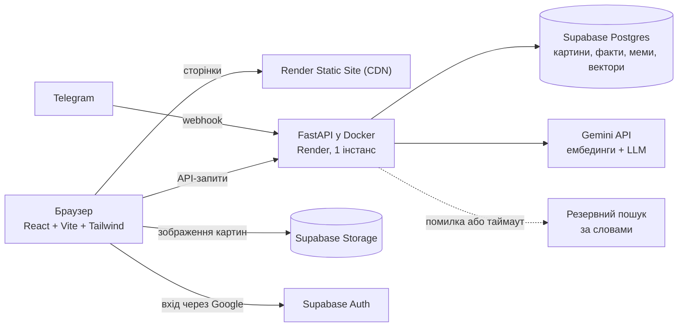
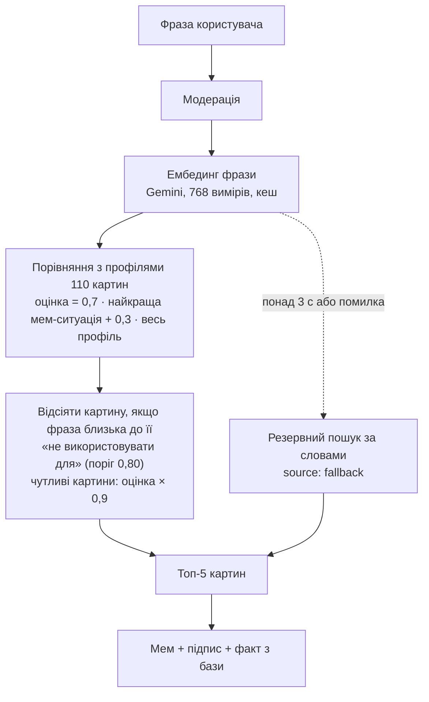
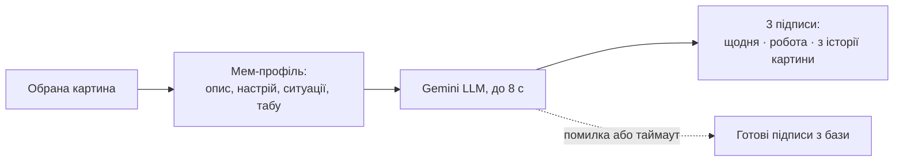
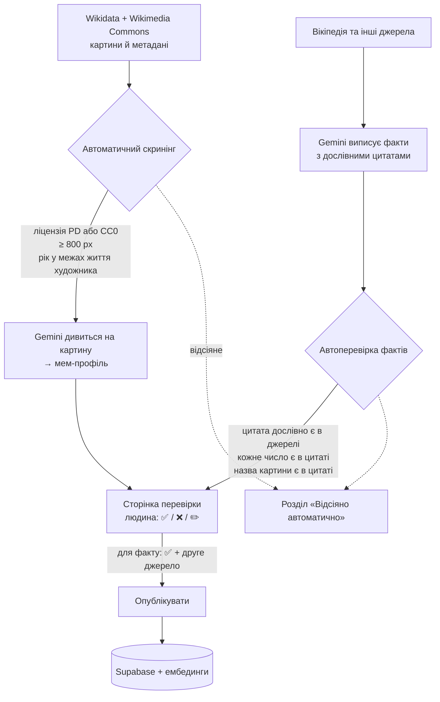

# Діаграми README (джерело Mermaid)

Зображення в `docs/readme/diagram-*.png` згенеровано з цих блоків. Змінили діаграму — оновіть і PNG.

## Система (`diagram-system.png`)

## Шлях I: фраза → картина (`diagram-phrase.png`)

## Шлях II: картина → підписи (`diagram-captions.png`)

## Збір і перевірка даних (`diagram-data.png`)

